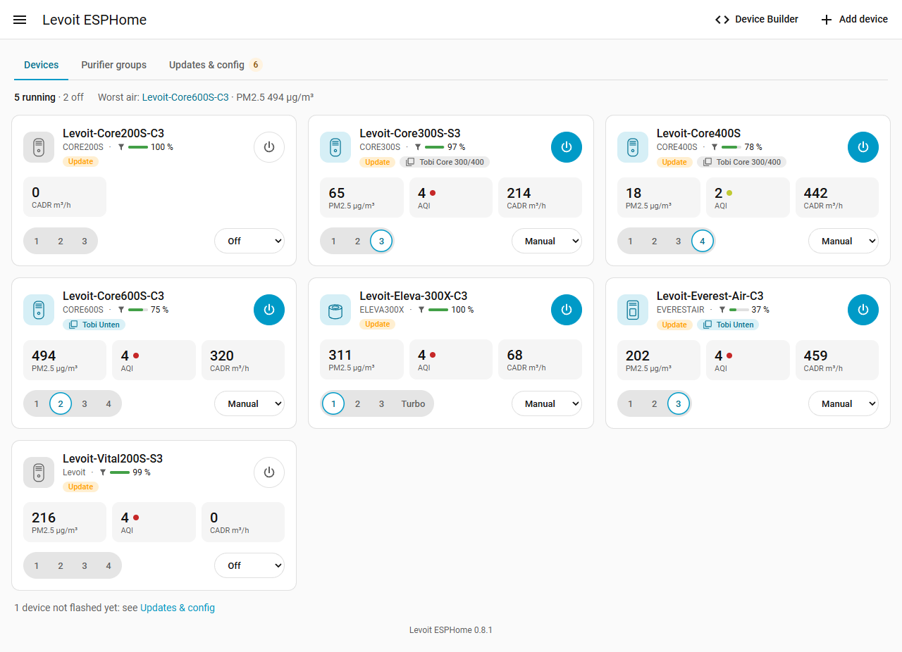
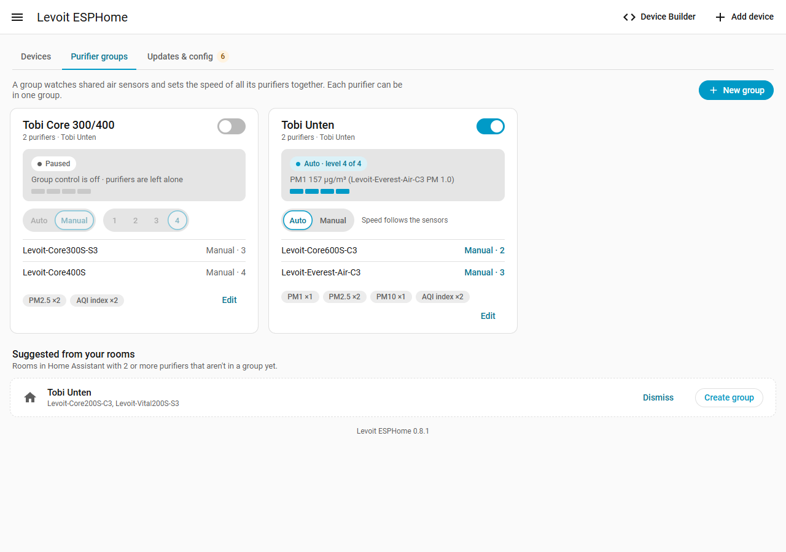
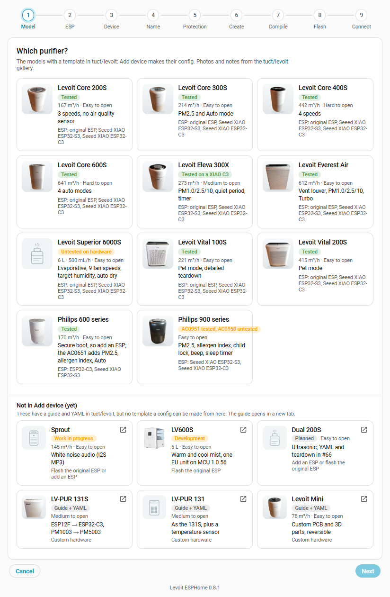
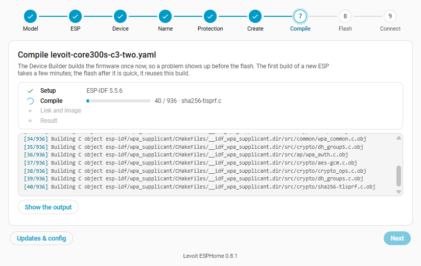

<div align="center">


# Levoit ESPHome

**The Home Assistant integration for purifiers running the [tuct/levoit](https://github.com/tuct/levoit) firmware.**<br>
Use them, run a room as one group, and update their firmware, all from Home Assistant.

[](#installation)
[](#requirements)
[](https://github.com/tuct/levoit-esphome-ha/releases/latest)
[](./LICENSE)

[](https://ko-fi.com/P4P721ETB5)

[Features](#features) · [Installation](#installation) · [Requirements](#requirements) · [Supported models](#supported-models) · [Documentation](#documentation)

</div>

## Features

### Your purifiers at a glance

A sidebar page with every purifier as a card: power, mode and speed, PM2.5,
AQI and CADR, an air quality dot, and the filter and timer left. A line on top
counts the purifiers running, off and offline, and names the one with the worst air.
[More](docs/sidebar-page.md#devices-tab)



### A page per purifier

Power, mode and speed with PM2.5, AQI and CADR on top, the air quality history
over 12 hours to 30 days in one chart, and all the settings grouped:
automatic, sleep, timer, display, filter.
[More](docs/sidebar-page.md#device-page)


### Dashboard cards

Three cards for any dashboard and every user, not only admins. They load by
themselves, with no resource to add.
[More](docs/sidebar-page.md#dashboard-cards)

**Purifier card:** one purifier in four sizes, from large to compact.


**Group card:** a group with its level, its combined PM2.5 and AQI, the total CADR and a chip per purifier, in four sizes.


**List card:** a row per group and purifier, the purifiers under their group, with PM2.5, mode, speed or level and power.


### Air purifier groups

Run two or more purifiers as one, for example everything in a room. Groups
run inside the integration, so they keep working with the page closed and
after a restart.

- **Auto from your air sensors.** PM1, PM2.5, PM10 and the purifiers' AQI
  give a level from 1 (very good) to 4 (poor), and the worst one counts. The
  level goes up at once and comes down one step at a time. A fast rise in
  PM2.5 jumps straight to 4.
- **Each purifier its own range.** Set a lowest and a highest step per
  purifier (Off, Sleep or a speed), and the levels are spread between them.
- **Hands off when you take over.** Change a purifier by hand and the group
  leaves it alone for 30 minutes. With no sensor value, it lets go entirely.
- **Manual** runs one level on every purifier in the group.
- **One fan entity per group**, for dashboards, voice and automations, with
  sensors for the level, the air quality, the combined PM values and the
  total CADR.
- **Rooms with two or more purifiers** are suggested as groups.

[More](docs/groups.md)




### Firmware updates

Every ESPHome device built with the `levoit` or `philips` component is found
and linked to its config in the ESPHome Device Builder. When the device's
channel has a newer component version, an update shows up under *Settings →
Updates* with its release notes.
[More](docs/updates.md)


*Install* compiles the config and uploads it over the air. You can follow
each step live: setup, compile with a file count, link, then the upload with
its percentage.


### Add a new purifier

*Add device* walks you through it, one step at a time. Pick the model, with
its photo and notes from [tuct/levoit](https://github.com/tuct/levoit), then
the ESP: the original one, a Seeed XIAO ESP32-S3 / C3, or your own board.
Give it a name and a channel, see exactly what gets written, and create the
config with its own keys. It compiles right away, with the build's steps
live; you flash it once over USB from the Device Builder, and after that,
updates come over the air.
[More](docs/updates.md#add-device)






> **Early version.** Part of the
> [firmware update plan](https://github.com/tuct/levoit/blob/main/docs/firmware-updates.md).

## Installation

[](https://my.home-assistant.io/redirect/hacs_repository/?owner=tuct&repository=levoit-esphome-ha&category=integration)

1. **Add the repository.** It is not in the default Marketplace catalog yet.
   Use the button above, or go to **Settings → Marketplace → ⋮ → Custom
   repositories**, enter `https://github.com/tuct/levoit-esphome-ha` and pick
   type *Integration* (needs a one-time GitHub sign-in).
2. **Install** *Levoit ESPHome* and restart Home Assistant.
3. **Add the integration** under **Settings → Devices & services**, or here:

   [](https://my.home-assistant.io/redirect/config_flow_start/?domain=levoit_esphome)
4. **Optional:** turn on **Configure → Show in the sidebar** for the
   *Levoit ESPHome* page.

## Requirements

* Home Assistant 2026.11 or newer
* The **ESPHome Device Builder add-on**, found by Home Assistant's ESPHome
  integration (Home Assistant OS or Supervised). A standalone Device Builder is
  not supported yet
* For installing updates: each device's config in that Device Builder, for
  example a pasted builder file from
  [tuct/levoit](https://github.com/tuct/levoit/tree/main/devices)
* The `esp_version` text sensor in the device config (the builder files have
  it); it is how the integration reads the installed version
* Optional, for devices without a Device Builder config: the `model` text sensor
  (`type: model`, tuct/levoit after 1.7.0)
* The channel comes from the component's source in the config:

  ```yaml
  external_components:
    - source:
        type: git
        url: https://github.com/tuct/levoit
        ref: stable      # or main
      components: [levoit]
      refresh: always    # fetch on every build; the default (1d) can rebuild an old commit
  ```

## Supported models

The templates *Add device* offers per model (✓). **Other ESP** works for every
model, with your board and pins.

| Model | XIAO ESP32-C3 | XIAO ESP32-S3 | Original ESP: updates through this integration |
|---|---|---|---|
| Levoit Core 200S | ✓ | ✓ | not tested yet |
| Levoit Core 300S | ✓ | ✓ | not tested yet |
| Levoit Core 400S | ✓ | ✓ | **works**: 1.3.1 → 1.7.2 ([walkthrough](docs/updates.md#original-esp-already-flashed-keep-it-updated)) |
| Levoit Core 600S | ✓ | ✓ | not tested yet |
| Levoit Eleva 300X | | ✓ | not tested yet (stock ESP32-C3) |
| Levoit Everest Air | ✓ | ✓ | not tested yet |
| Levoit Superior 6000S | | ✓ | not tested yet |
| Levoit Vital 100S | ✓ | ✓ | not tested yet (stock ESP32-C3) |
| Levoit Vital 200S | ✓ | ✓ | not tested yet (stock ESP32-C3) |
| Philips 600 series (AC0650) | ESP32-C3 template | ✓ | not possible: secure boot |
| Philips 900 series (AC0950) | ✓ | ✓ | |

> **Running the `levoit` firmware on the original ESP of one of these?**
> Add it with *Add device* → *Device already in Home Assistant*, install an
> update, and [tell us how it went](https://github.com/tuct/levoit-esphome-ha/issues/new?title=Original%20ESP%3A%20%3Cmodel%3E):
> the model, and whether the update went through. Each report moves a model
> in this table from *not tested yet* to *works*.

## Documentation

| Page | What is in it |
|---|---|
| [Sidebar page and dashboard cards](docs/sidebar-page.md) | The Devices tab, the device page with its history and settings, and the purifier, group and list cards |
| [Purifier groups](docs/groups.md) | Making a group, how *Auto* follows the air, and the group's fan entity |
| [Manage and update](docs/updates.md) | The Updates & config tab, extra or original ESP, *Add device*, encrypted OTA, and how an update reaches the purifier |
| [Entities per purifier](docs/entities.md) | What the integration adds for each purifier |
| [Development](docs/development.md) | Tests, and how the README screenshots are made |

The firmware, the device configs and the wiring guides live in
**[tuct/levoit](https://github.com/tuct/levoit)**.
