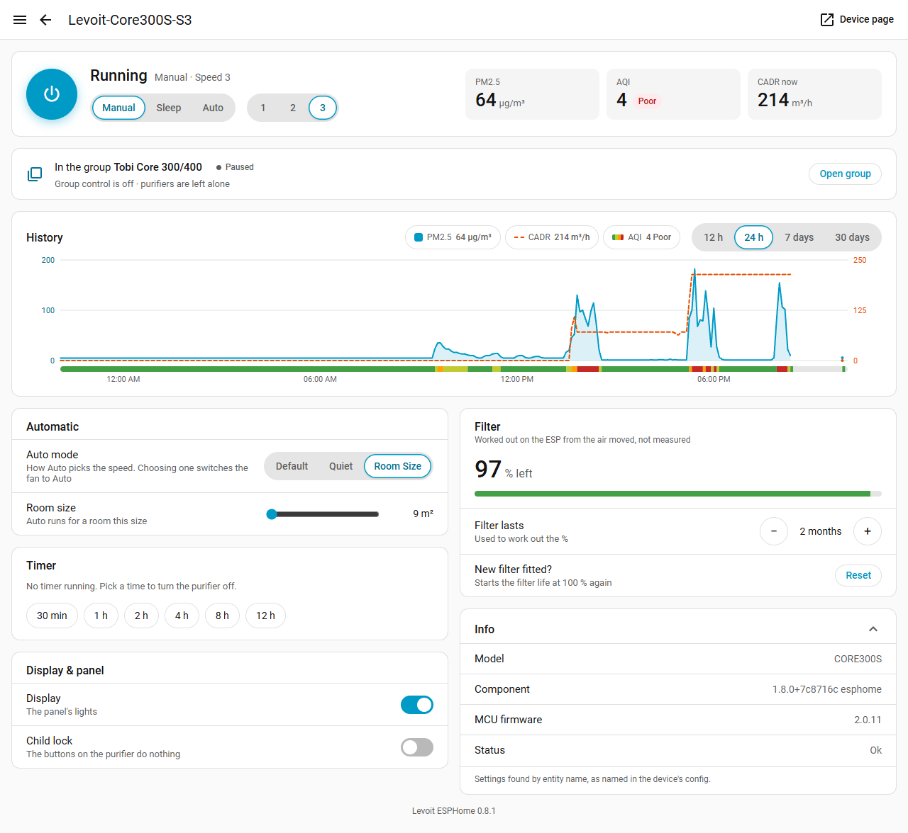
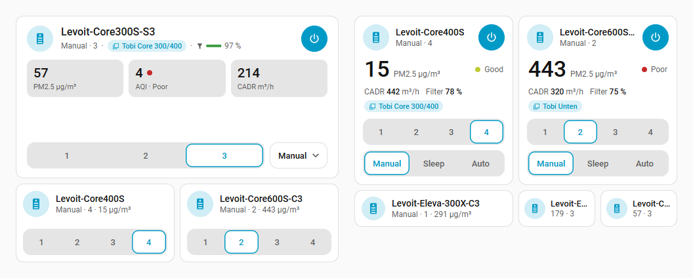
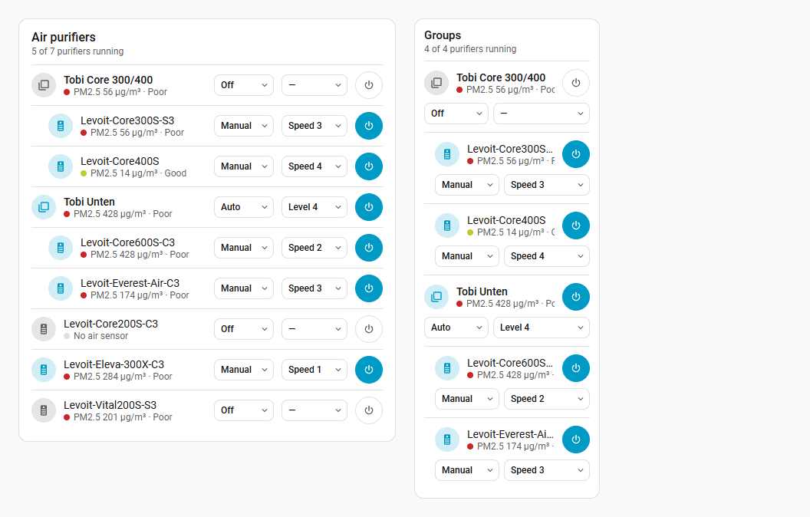
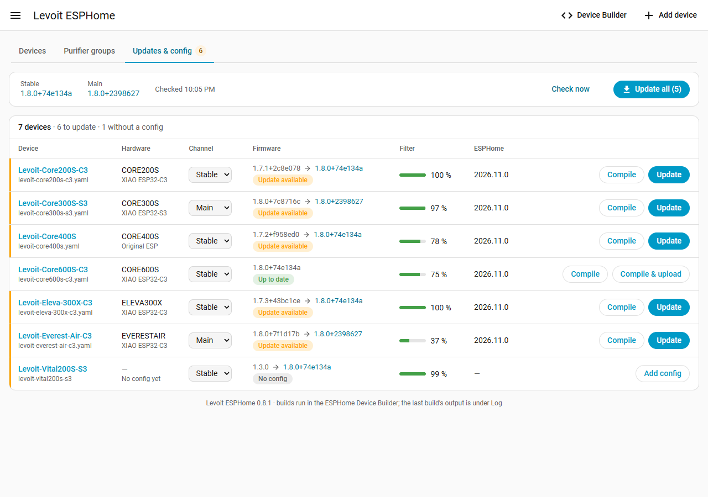
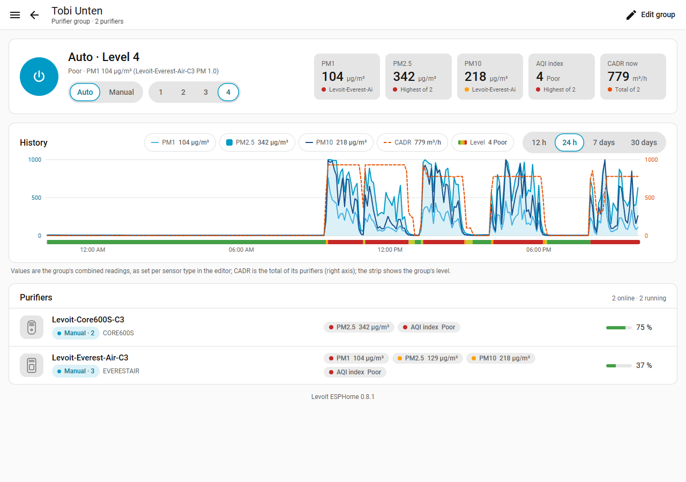

<div align="center">


# Levoit ESPHome

**The Home Assistant integration for purifiers running the [tuct/levoit](https://github.com/tuct/levoit) firmware.**<br>
Use them, run a room as one group, and update their firmware, all from Home Assistant.

[](#installation)
[](#requirements)
[](https://github.com/tuct/levoit-esphome-ha/releases/latest)
[](./LICENSE)

[](https://ko-fi.com/P4P721ETB5)

[Features](#features) · [Installation](#installation) · [Requirements](#requirements) · [Supported models](#supported-models) · [Documentation](#documentation)

</div>

## Features

### A UI for your Levoit ESPHome devices

**Use them.** A sidebar page with every purifier as a card: power, mode and
speed, PM2.5, AQI and CADR at a glance. Each purifier has a page of its own
with its air quality history and all its settings, grouped instead of one long
list. [More](docs/sidebar-page.md)

<p>
  
  
</p>

**Put them on any dashboard.** Three cards, *Levoit purifier*, *Levoit
group* and *Levoit list*, for every user, not only admins. They load by
themselves, with no resource to add. [More](docs/sidebar-page.md#dashboard-cards)

<p>
  
  
</p>

**Manage and update them.** It finds every ESPHome device built with the
`levoit` or `philips` component and links it to its config in the ESPHome
Device Builder. When the device's channel has a newer component version, an
update shows up under *Settings → Updates* with its release notes. *Install*
compiles the config and uploads it over the air, and you can follow each step
live: setup, compile with a file count, link, then the upload with its
percentage. *Add device* makes the config for a new purifier.
[More](docs/updates.md)

<p>
  
  
</p>
<p>
  
  
</p>

### Air purifier groups

Run two or more purifiers as one, for example everything in a room. Groups
run inside the integration, so they keep working with the page closed and
after a restart.

- **Auto from your air sensors.** PM1, PM2.5, PM10 and the purifiers' AQI
  give a level from 1 (very good) to 4 (poor), and the worst one counts. The
  level goes up at once and comes down one step at a time. A fast rise in
  PM2.5 jumps straight to 4.
- **Each purifier its own range.** Set a lowest and a highest step per
  purifier (Off, Sleep or a speed), and the levels are spread between them.
- **Hands off when you take over.** Change a purifier by hand and the group
  leaves it alone for 30 minutes. With no sensor value, it lets go entirely.
- **Manual** runs one level on every purifier in the group.
- **Off is off.** Turning the group off turns its purifiers off.
- **One fan entity per group**, for dashboards, voice and automations. It
  comes with sensors for the level, the air quality, the combined PM values
  and the total CADR.
- **A page per group** with its history and the level as a band, and an
  editor that shows live what the group would do. Rooms with two or more
  purifiers are suggested as groups.

[More](docs/groups.md)

<p>
  
  
</p>

> **Early version.** Part of the
> [firmware update plan](https://github.com/tuct/levoit/blob/main/docs/firmware-updates.md).

## Installation

[](https://my.home-assistant.io/redirect/hacs_repository/?owner=tuct&repository=levoit-esphome-ha&category=integration)

1. **Add the repository.** It is not in the default Marketplace catalog yet.
   Use the button above, or go to **Settings → Marketplace → ⋮ → Custom
   repositories**, enter `https://github.com/tuct/levoit-esphome-ha` and pick
   type *Integration* (needs a one-time GitHub sign-in).
2. **Install** *Levoit ESPHome* and restart Home Assistant.
3. **Add the integration** under **Settings → Devices & services**, or here:

   [](https://my.home-assistant.io/redirect/config_flow_start/?domain=levoit_esphome)
4. **Optional:** turn on **Configure → Show in the sidebar** for the
   *Levoit ESPHome* page.

## Requirements

* Home Assistant 2026.11 or newer
* The **ESPHome Device Builder add-on**, found by Home Assistant's ESPHome
  integration (Home Assistant OS or Supervised). A standalone Device Builder is
  not supported yet
* For installing updates: each device's config in that Device Builder, for
  example a pasted builder file from
  [tuct/levoit](https://github.com/tuct/levoit/tree/main/devices)
* The `esp_version` text sensor in the device config (the builder files have
  it); it is how the integration reads the installed version
* Optional, for devices without a Device Builder config: the `model` text sensor
  (`type: model`, tuct/levoit after 1.7.0)
* The channel comes from the component's source in the config:

  ```yaml
  external_components:
    - source:
        type: git
        url: https://github.com/tuct/levoit
        ref: stable      # or main
      components: [levoit]
      refresh: always    # fetch on every build; the default (1d) can rebuild an old commit
  ```

## Supported models

The templates *Add device* offers per model (✓). **Other ESP** works for every
model, with your board and pins.

| Model | XIAO ESP32-C3 | XIAO ESP32-S3 | Original ESP: updates through this integration |
|---|---|---|---|
| Levoit Core 200S | ✓ | ✓ | not tested yet |
| Levoit Core 300S | ✓ | ✓ | not tested yet |
| Levoit Core 400S | ✓ | ✓ | **works**: 1.3.1 → 1.7.2 ([walkthrough](docs/updates.md#original-esp-already-flashed-keep-it-updated)) |
| Levoit Core 600S | ✓ | ✓ | not tested yet |
| Levoit Eleva 300X | | ✓ | not tested yet (stock ESP32-C3) |
| Levoit Everest Air | ✓ | ✓ | not tested yet |
| Levoit Superior 6000S | | ✓ | not tested yet |
| Levoit Vital 100S | ✓ | ✓ | not tested yet (stock ESP32-C3) |
| Levoit Vital 200S | ✓ | ✓ | not tested yet (stock ESP32-C3) |
| Philips 600 series (AC0650) | ESP32-C3 template | ✓ | not possible: secure boot |
| Philips 900 series (AC0950) | ✓ | ✓ | |

> **Running the `levoit` firmware on the original ESP of one of these?**
> Add it with *Add device* → *Device already in Home Assistant*, install an
> update, and [tell us how it went](https://github.com/tuct/levoit-esphome-ha/issues/new?title=Original%20ESP%3A%20%3Cmodel%3E):
> the model, and whether the update went through. Each report moves a model
> in this table from *not tested yet* to *works*.

## Documentation

| Page | What is in it |
|---|---|
| [Sidebar page and dashboard cards](docs/sidebar-page.md) | The Devices tab, the device page with its history and settings, and the purifier, group and list cards |
| [Purifier groups](docs/groups.md) | Making a group, how *Auto* follows the air, and the group's fan entity |
| [Manage and update](docs/updates.md) | The Updates & config tab, extra or original ESP, *Add device*, encrypted OTA, and how an update reaches the purifier |
| [Entities per purifier](docs/entities.md) | What the integration adds for each purifier |
| [Development](docs/development.md) | Tests, and how the README screenshots are made |

The firmware, the device configs and the wiring guides live in
**[tuct/levoit](https://github.com/tuct/levoit)**.
