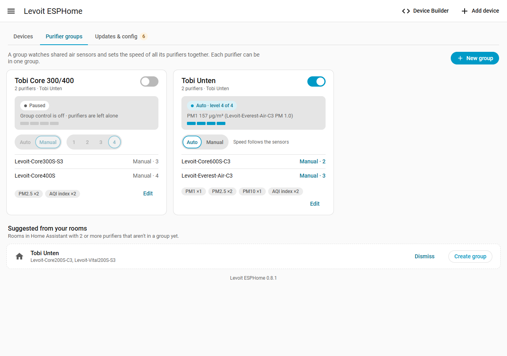
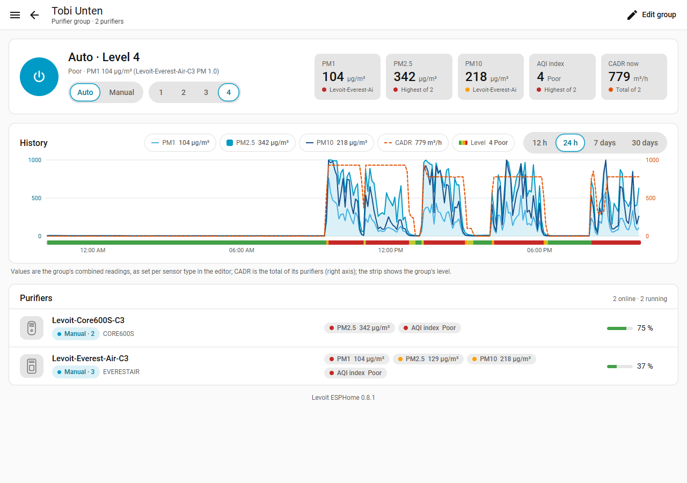
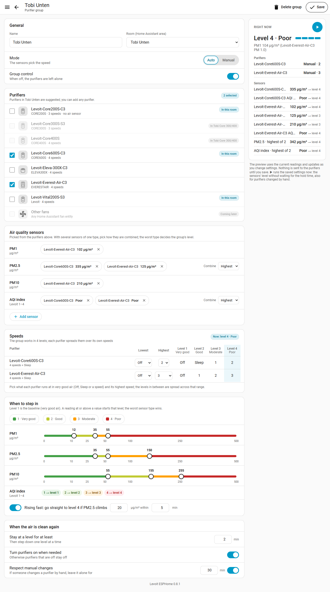

# Purifier groups

Run 2 or more purifiers together from shared air sensors, for example
everything in one room. Groups run in the integration, so they keep working
with the page closed and after a restart.

* **The level:** 1 (very good air) to 4 (poor). Each sensor type (PM1, PM2.5,
  PM10, the purifiers' AQI index) gives a level: PM values on the group's
  thresholds, the AQI index 1–4 as it is. Several sensors of one type are
  combined into one value: the highest (default), average, median or lowest.
  The worst type sets the group's level. It goes up at once and down one step
  per hold time (2 minutes); a fast rise in PM2.5 jumps straight to level 4.
* **The purifiers** each have a lowest and a highest step. Level 1 runs at the
  lowest (Off, Sleep or a speed; speed 1 by default), level 4 at the highest,
  and levels 2 and 3 in between. With 4 steps in that range or fewer, each
  level takes the next step and the rest stay at the highest (Sleep to 3:
  Sleep, 1, 2, 3; 1 to 2: 1, 2, 2, 2). With more, levels 2 and 3 are spread
  evenly, Sleep counting as half a speed, and the bigger jumps come first (Off
  to 4: Off, 2, 3, 4). The Everest Air counts its Turbo as speed 4, so its
  highest is Turbo unless set to 3.
* **Off:** turning the group off (its switch, its fan, the power button, or
  *Group control* in the editor) turns its purifiers off.
* **Letting go:** when no sensor has a value, the group is deleted, or a
  purifier leaves it, the group sends nothing: each keeps running as it is.
* **By hand:** if someone changes a purifier, the group leaves that one alone
  for 30 minutes.
* **Manual:** one level for all its purifiers instead of following the sensors.
* **Apply now:** ▶ in the editor runs the saved settings at once: the
  sensors' level without waiting for the hold time, also for purifiers that
  were changed by hand.

Each group has a page of its own: power, Auto or Manual and the level, a tile
per sensor type with the group's combined value and the purifiers' total
CADR, their history over 12 hours, 24 hours, 7 days or 30 days with the level
as a band, and its
purifiers with their state, sensors and filter. *Edit group* opens the editor.

The editor picks the sensors from the purifiers and takes others from Home
Assistant, sets how several sensors of one type are combined, the thresholds,
the hold time and each purifier's lowest and highest step, and shows live what
the group would do right now. Rooms in Home Assistant with 2 or more purifiers
are suggested as groups.

Each group gets a device of its name, for dashboards, voice and automations:

| Entity | What it shows / does |
|--------|----------------------|
| **The group** (fan) | The whole group like one purifier: on / off is *Control*, preset *Auto* or *Manual*, and its 4 speeds set the level for all purifiers (Manual) |
| **Control** (switch) | Off: the group leaves its purifiers alone |
| **Level** (sensor) | 1–4, the level the group runs at, with the reason; 0 while it lets go |
| **Air quality** (sensor) | 1–4, the worst sensor type on the group's thresholds; also in Manual or with the group off |
| **Active** (binary sensor) | On while the group runs its purifiers |
| **PM1**, **PM2.5**, **PM10**, **AQI index** (sensors) | The group's combined value of each sensor type it has (as set in the editor: highest, average, median or lowest), with its level and sensors. Only for the types the group has a sensor of: added and removed as you change its sensors |
| **CADR** (sensor) | The total CADR of its purifiers, m³/h |

Groups saved by 0.6 keep working: their sensors of the Eleva's 0–500 AQI
are dropped, PM2.5 keeps where levels 2–4 started, and the max speed and *Up
to* become each purifier's highest speed. Level 1 now runs the purifiers at
their lowest step instead of letting go.

[← Back to the README](../README.md)
