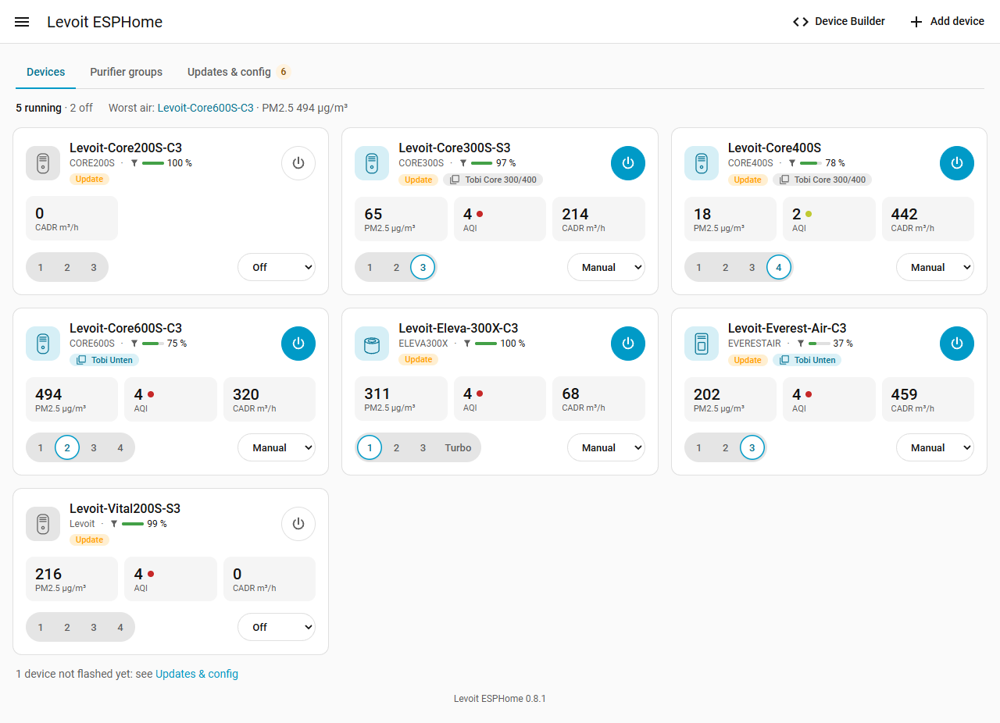
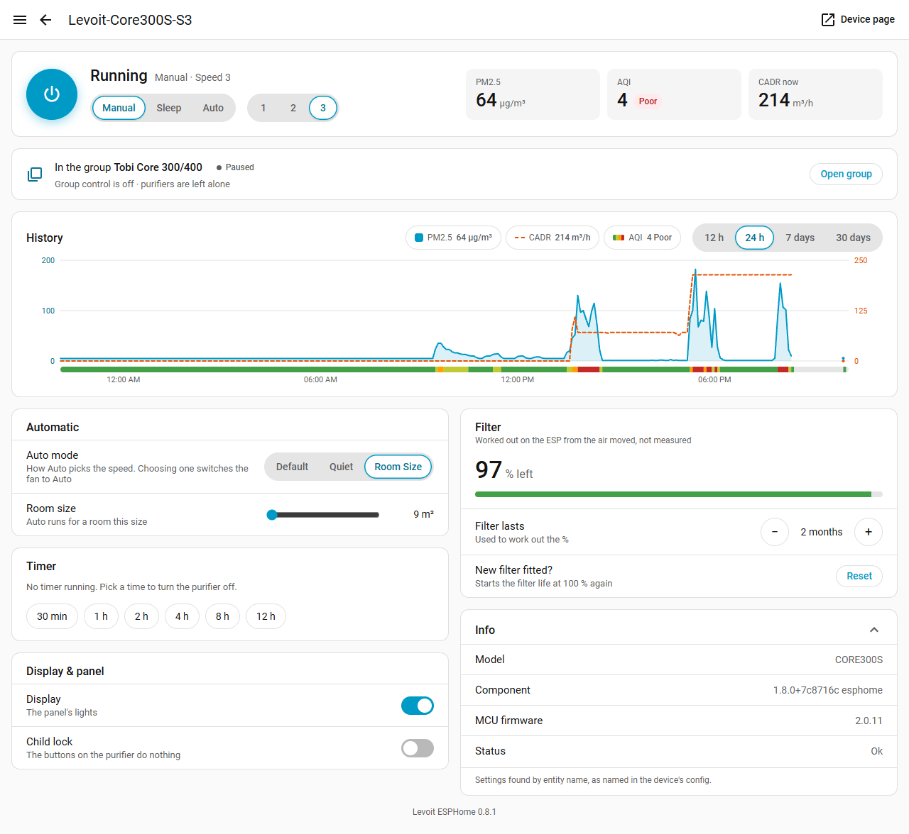
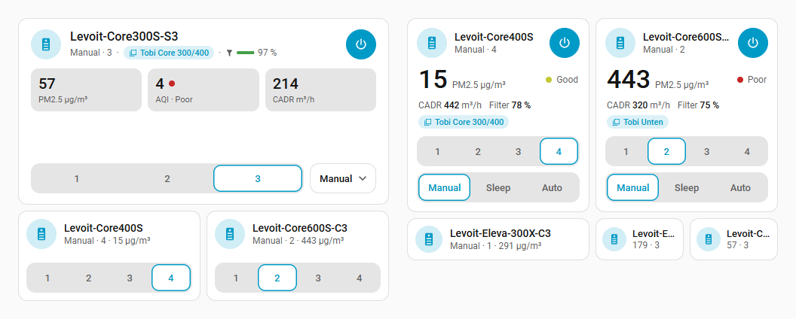
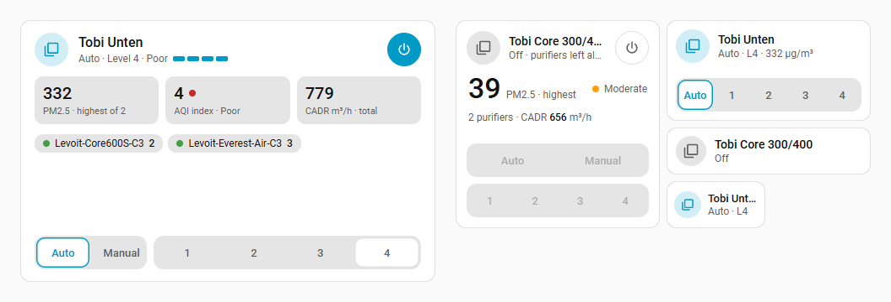
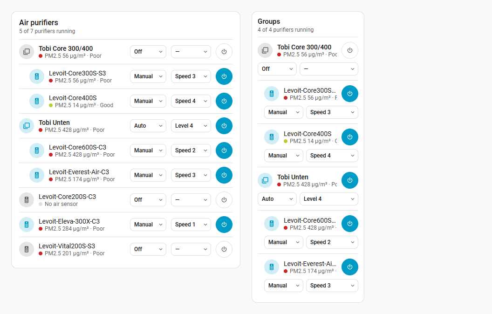

# Use and set up your purifiers

Turn on **Settings → Devices & services → Levoit ESPHome → ⚙ (Configure) →
Show in the sidebar** for a *Levoit ESPHome* page, visible to admins only. It
has three tabs and updates live. It is a plain web component served by the
integration; nothing is loaded from outside Home Assistant. After updating the
integration, reload the browser once to get the new page.

## Devices tab

Every purifier as a card, for using them. A line on top counts the purifiers
running, off and offline, and names the one with the worst air. Each card has a
small photo of the model (from tuct/levoit; an outline drawing while it loads
or where there is none), an air quality dot, power, the mode and the speed,
PM2.5, AQI (the level 1–4 and its word, *1 Very good* to *4 Poor*) and the
current CADR, the filter left, and the time left when a timer runs. Chips under
the model show an update that is out and the purifier's group (tinted while
the group runs it). Offline cards keep their controls, greyed out. Click a
card for the device's page.



## Device page

On top, power, mode and speed with PM2.5, AQI and CADR (the Eleva 300X also
shows its AQI index, 0–500). Below, the **history** of the last 12 hours, 24
hours, 7 days or 30 days from Home Assistant's statistics, in one chart: PM2.5 as an area
(left axis), CADR as a dashed line (right axis) and the air quality level as a
coloured band under it; the legend chips switch each one on and off. A
purifier in a group shows a banner with the group's status and what a change
here does.

Then the settings, grouped instead of one long list: *Automatic* (auto mode,
room size only when it applies), *Sleep* (the Vital 200S custom profile: quick
clean, sleep, then daytime mode), *Quiet period* (Eleva 300X, start and end as
times), *Timer* (quick picks and the time left), *Display & panel*, *Filter*
(life %, lifetime, reset) and *Info*. For the Core 200S / 300S / 400S / 600S,
Vital 100S / 200S, Everest Air and Eleva 300X; other models link to Home
Assistant's device page. It needs no Device Builder config: the settings are
found by their entity names, as the tuct/levoit configs name them (or as the
device's config does, when there is one).



## Dashboard cards

Cards for any Home Assistant dashboard, for every user (not only admins). The
integration loads them on every page: no resource to add. In the dashboard
editor, *Add card* lists them as **Levoit purifier**, **Levoit group** and
**Levoit list**.

### Purifier card

```yaml
type: custom:levoit-purifier-card
entity: fan.levoit_core600s_c3_fan   # the purifier's fan
show: [pm25, aqi, cadr, filter, group]   # no key: all; a new card lists them
controls: [speed, mode]                  # default: both
grid_options:
  columns: 12   # 6 = medium / small, 3 = compact
  rows: 4       # 4 = large / medium, 2 = small, 1 = compact
```

The card follows its size in a sections view: **large** (12 × 4) with PM2.5,
AQI and CADR, the speeds and a mode list; **medium** (6 × 4) with PM2.5 large,
CADR, filter, speeds and modes; **small** (6 × 2) with the speeds; **compact**
(6 × 1 or 3 × 1) with the state only. The icon or the name opens the fan's
dialog; on the small and compact cards the icon turns it on and off. Turbo
shows as the top speed (the Everest Air's Turbo mode, the Eleva's level 4).
In Sleep, Auto or Pet the speeds are dimmed and show what it runs at; picking
one switches to Manual.



### Group card

```yaml
type: custom:levoit-group-card
entity: fan.living_room   # the group's fan (or group: <its id>)
show: [pm25, aqi, cadr, members]   # no key: all; a new card lists them
controls: [mode, level]            # default: both
grid_options:
  columns: 12   # 6 = medium / small, 3 = compact
  rows: 5       # 4 = medium, 2 = small, 1 = compact
```

**Large** (12 × 5): the status with the level as 4 bars, PM2.5 (and how it is
combined, "avg of 4"), the AQI index, the total CADR, a chip per purifier with
what it runs at, Auto / Manual and the levels. **Medium** (6 × 4): PM2.5 large
with the air quality, the purifiers and CADR, Auto / Manual and the levels.
**Small** (6 × 2): Auto and the levels in one row. **Compact** (6 × 1 or
3 × 1): "Auto · L4 · 360 µg/m³". The power button (on small cards the icon) is
the group's control: off lets go of the purifiers and greys out the controls.
A level switches the group to Manual at that level. Without an AQI index the
group shows its air quality (its own thresholds, 1–4).



### List card

```yaml
type: custom:levoit-list-card
title: Air purifiers
items: all            # groups / devices / a list of group ids and fan ids
nest_members: true    # the purifiers under their group
controls: [mode, speed, power]
grid_options:
  columns: 12         # 6 = narrow: the controls on a second line
  rows: auto
```

A row per group and purifier: its PM2.5 and air quality, the mode and the
speed (for a group the level) as lists, and power. The name opens the dialog.



[← Back to the README](../README.md)
