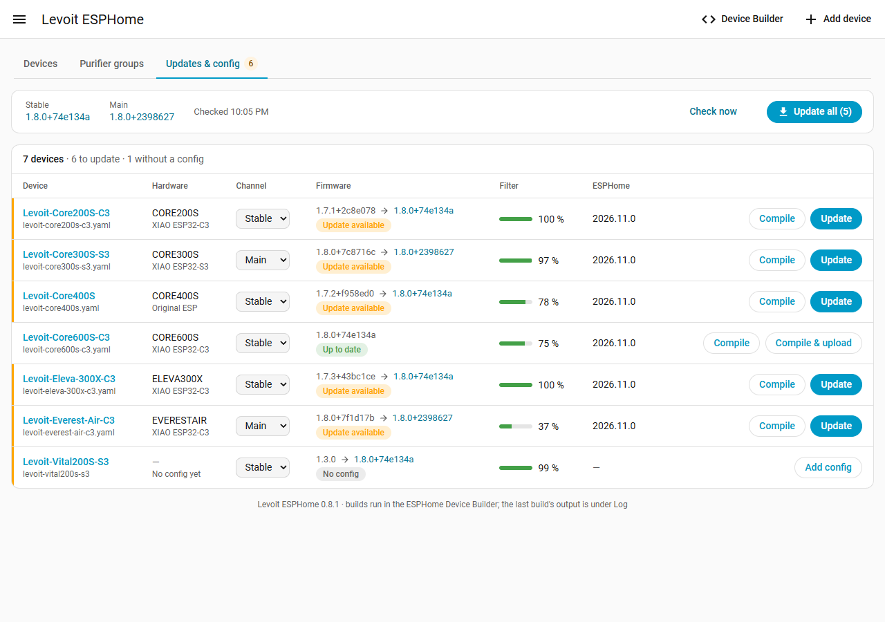
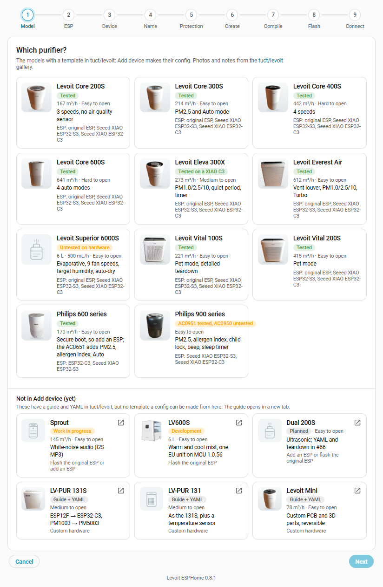
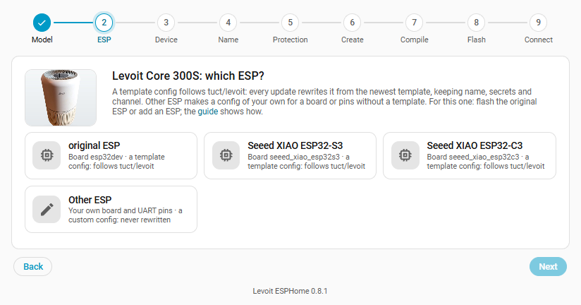
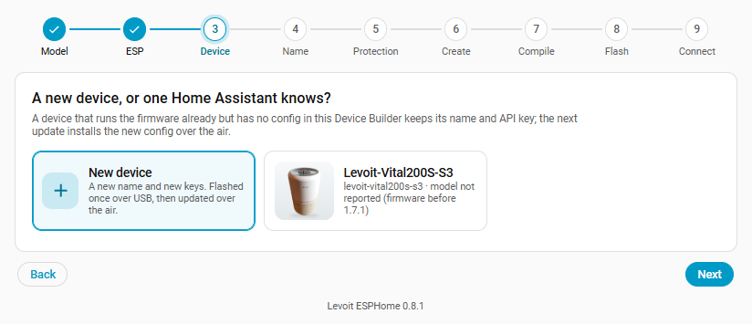
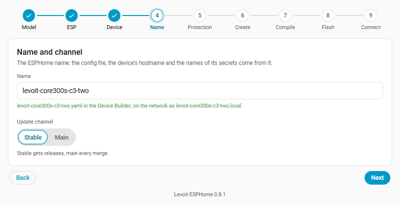
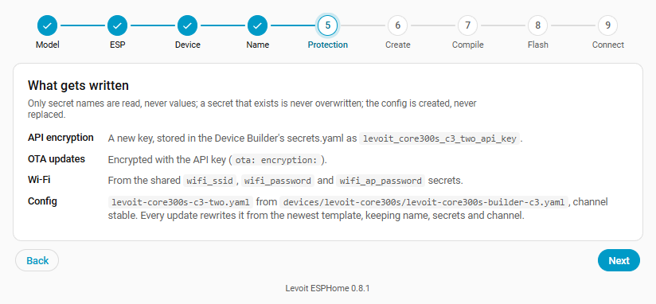
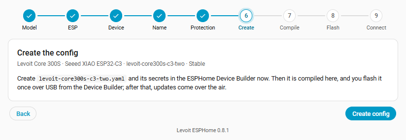
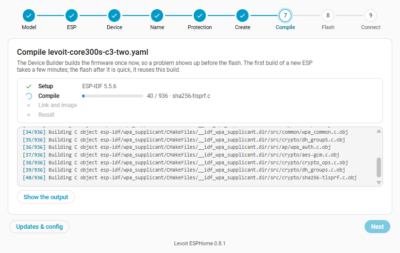

# Manage and update the devices

Firmware updates for every purifier, in Home Assistant's *Updates* and on
the sidebar page's *Updates & config* tab, and *Add device* for new ones.

## Updates & config tab

The sidebar page's third tab has:

* every device: model, ESP / config type, channel, installed → latest
  component version, filter %, ESPHome version, status and the last build
* the latest releases on top, with **Update all** (one device after the other)
* **Compile** and **Compile and upload** (*Update* when one is out), with the
  build's step and progress live per device (the compile counter, the upload
  bar), the result, and under **Log** the steps with the last lines or the
  full output
* the channel of a device without a config or with a template config
* configs made by *Add device* that are **not flashed yet**, with what to do
  next; they can be compiled, but not uploaded until the first USB flash
* links to each device's page, the Device Builder and Add device; *check now*
  reads the latest versions from GitHub without waiting for the 6 hours

A running build, in the row and under **Log**: the steps, the compile counter
with the file being built, then the upload with its bar.

## Extra ESP or original ESP

Most of these purifiers have an ESP32 for Wi-Fi and a separate MCU that runs
the purifier, talking over UART. ESPHome can run on that ESP in two ways:

| | **Extra ESP** (recommended) | **Original ESP** |
|---|---|---|
| What | A small ESP of your own, wired to the MCU's UART; the original ESP stays on the board, held in reset | The purifier's own ESP, flashed with ESPHome |
| Hardware | A [Seeed XIAO ESP32-C3](https://www.seeedstudio.com/Seeed-XIAO-ESP32C3-p-5431.html) or [XIAO ESP32-S3](https://www.seeedstudio.com/XIAO-ESP32S3-p-5627.html) (or any ESP32 ESPHome supports) and a few wires: power, GND, RX, TX, and the original ESP's EN to GND | None |
| Back to stock | Remove the wires: the stock firmware was never touched | Restore a backup of the stock flash over its UART pads |
| First flash | Over USB from the Device Builder, before you wire it in | Over the board's UART pads, usually with the purifier open |
| Risk | Low: a bad build only hits your ESP, which you can reflash over USB at your desk | A bad build can leave the purifier offline until you open it again |
| Locked modules | Works with every model, also those whose stock ESP can't be flashed (Philips AC0650: secure boot) | Only modules without secure boot |

**Why extra:** the purifier's stock firmware stays intact, and a broken build
is never more than a USB cable away from fixed. The XIAO boards are small
enough to fit inside many of these purifiers (the device guides say where).

## Extra ESP: install it and keep it updated

1. *Add device* → **New device** → the model → **Seeed XIAO ESP32-C3** or
   **Seeed XIAO ESP32-S3**. For another board pick **Other ESP**: any ESPHome
   board name and your own RX / TX pins.
2. The integration makes the Device Builder config: name, API key and OTA
   password generated, Wi-Fi from your secrets.
3. Flash it once over USB from the Device Builder (the config → **Install** →
   **Plug into this computer**), then wire it in (see the model's guide in
   [tuct/levoit/devices](https://github.com/tuct/levoit/tree/main/devices)).
   Until then the sidebar page lists it as *Not flashed yet*. Once it is on
   your Wi-Fi, the integration adds it to Home Assistant's ESPHome
   integration by itself: no *discovered device* to confirm.
4. From then on, every new component version shows up in **Settings →
   Updates** and installs over the air.

## Original ESP, already flashed: keep it updated

Flashed the purifier's own ESP with the `levoit` component already? *Add
device* → **Device already in Home Assistant** → the model → **Original ESP**
gives it a Device Builder config. It keeps its name and API key (Home Assistant
keeps the device), and updates come over the air like for any other device.

<b>Walkthrough:</b> a Core 400S on its original ESP, from 1.3.1 to 1.7.2

1. *Add device* → **Device already in Home Assistant, without a config**

   

2. Pick the device. Its config gets the device's own name and API key

   

3. The model: asked here because firmware 1.3.1 has no `model` sensor yet

   

4. **Original ESP**

   

5. Channel, and the OTA password the device was built with (the API key comes from Home Assistant)

   

6. The config is in the Device Builder

   

7. The sidebar page lists it as **Original ESP** with an update from 1.3.1

   

8. **Update** asks first

   

9. It compiles in the Device Builder …

   

10. … uploads over the air (ESPHome 2026.5.3 on the device, 2026.11.0 in the Device Builder) …

    

11. … and the purifier runs 1.7.2 and ESPHome 2026.11.0

    

## Already running, but no config in the Device Builder

A purifier that runs the `levoit` or `philips` firmware already (extra or
original ESP), but whose config is not in this Device Builder: flashed from a
PC with the ESPHome CLI, from another Device Builder, or the config is lost.

The integration finds it anyway, by its `esp_version` (or `model`) sensor: it
shows on the sidebar page with **No config**, and its update entity says when a
new version is out, but cannot install it yet. To onboard it:

1. *Add device* → **Device already in Home Assistant, without a config** →
   pick the device. (**Add config** on its row of the sidebar page starts the
   same for that device, as a guided page.)
2. **Model:** skipped when the device reports it; firmware older than 1.7.1
   has no `model` sensor, so pick it.
3. **ESP:** the template that matches its hardware (XIAO ESP32-C3, XIAO
   ESP32-S3, original ESP), or **Other ESP** with its board and the RX / TX
   pins it uses now. **They must match how the device is wired**: the next
   update flashes this config. With wrong pins the ESP still starts and stays
   on Wi-Fi, but can't talk to the purifier; fix the pins and update again,
   over the air. With a wrong board the new firmware may not start at all,
   and then only a USB reflash helps. If unsure, take board and pins from the
   config it was built with.
4. **Channel**, and its **OTA password** if it has one: Home Assistant does
   not know it, and the update is uploaded with it. Leave it empty if the
   device has none.

The config keeps the device's **name**, so Home Assistant keeps the device and
its history, and its **API encryption key**, taken from Home Assistant's
connection to the device and stored as `<name>_api_key` in `secrets.yaml`.
Wi-Fi comes from the `wifi_ssid` / `wifi_password` / `wifi_ap_password`
secrets, which must exist. The device moves from *No config* to *Update
available*; the first update builds the new config and installs it over the air.

Have the old config at hand and want to keep it as it is? Paste it into the
Device Builder instead (under the device's name). The integration picks it up
as a **custom** config; a pasted builder file of tuct/levoit counts as a
template.

## Add device

**Settings → Devices & services → Levoit ESPHome → Add device** makes a Device
Builder config from a template of tuct/levoit
([`devices/templates.json`](https://github.com/tuct/levoit/blob/main/devices/templates.json)):
pick the model and the ESP (original, Seeed XIAO ESP32-C3, ESP32-C3, Seeed XIAO ESP32-S3),
or **Other ESP** for a board or pins without a template: enter the ESPHome board
name (e.g. `seeed_xiao_esp32s3`, `esp32dev`, `esp32-c6-devkitc-1`) and the RX / TX
pins, and the config is made from the model's builder file with those.

The sidebar page's **Add device** (and **Add config** on the row of a device
without one) does the same as a guided page, one screen per step: the model,
the ESP, a new device or one Home Assistant knows, name and channel, what
gets written (keys, OTA protection, the Wi-Fi secrets, the config), then
Create. The name is checked against the Device Builder as you type. Both
routes make the same config. Each model shows its photo, status, spec and
how easy it is to open, from tuct/levoit's
[`devices/onboarding.json`](https://github.com/tuct/levoit/blob/main/devices/onboarding.json)
(read from GitHub, so it grows without an update here); devices without a
template are listed with a link to their guide. The guided page then carries on:

* **New device:** it compiles the config right away, with the build's steps
  live, so a problem shows before the flash; then it says how to flash it
  over USB (with a button that opens the Device Builder in a new tab) and
  waits until the device is on the network and in Home Assistant, which
  ends on its device page. Leaving the page is fine: the config is listed as
  *Not flashed yet* and added once the device connects
* **Existing device:** **Install over the air** compiles and uploads it, as
  *Update* does, and ends on its device page

**1. Model**

**2. ESP**

**3. Device**

**4. Name**

**5. Protection**

**6. Create**

**7. Compile**

* **New device:** a name is suggested; a new API encryption key is
  generated and stored in the Device Builder's `secrets.yaml` as
  `<name>_api_key`, and OTA updates are encrypted with it (a Device Builder
  older than ESPHome 2026.9.0 gets an OTA password instead, as
  `<name>_ota_password`). Flash it once over USB from the Device Builder;
  after that, updates come over the air. As soon as the
  flashed ESP is on the network (every 30 s it looks for `<name>.local`), the
  integration adds it to the ESPHome integration with the key from the Device
  Builder, so there is no discovered device to confirm. If the ESP needs
  input it cannot give (a different key, a name clash), it is left to Home
  Assistant's usual discovery
* **Device already in Home Assistant without a config:** it keeps its name
  and its API encryption key, which is taken from Home Assistant's ESPHome
  connection to the device (none there: no encryption) and stored as
  `<name>_api_key`. Home Assistant does not know the OTA password, so the
  flow asks for it (leave it empty if the device has none). After its first
  update here, OTA updates are encrypted with the key too (below)
* Wi-Fi comes from the shared `wifi_ssid`, `wifi_password` and
  `wifi_ap_password` secrets, which must exist. The integration reads secret
  **names** only, never values, and never overwrites an existing secret

**Template configs follow the templates.** A config made from a template (or a
pasted builder file) is recognised by its first line,
`# levoit-esphome-ha: template=...`. Every update rewrites it from the newest
builder file first, keeping its name, secrets and channel, then compiles and
uploads. The header under that line says so. **To customise such a config,
delete its first line first**: otherwise the next update overwrites your
changes. Without it the config is **custom**, like one made with *Other ESP*:
it is never rewritten, and updates only build the newer component it pulls
through its `ref:`.

### Encrypted native OTA

New configs encrypt OTA updates with the device's API key (`ota: encryption:`
without a key of its own). Template refreshes preserve the native ESPHome OTA
encryption key and API key, whether inline or referenced by `!secret`. If
`ota.encryption` is left empty, OTA continues to use the API encryption key.
An explicit OTA key must resolve to the same value as a configured API key.
The integration inspects the YAML without loading packages or looking up
secret values. Refresh supports a standalone template with the native API,
one native OTA transport, and an upstream Main or Stable source. Other layouts
stop before writing or building. Key rotation (`old_key`) and migration that
permits a plaintext upload (`allow_plaintext_upload`) also require a custom
config. Remove the template marker to manage that file manually. Use a Device
Builder version that supports native OTA encryption for an encrypted device.

**From an OTA password to encryption.** A template config made before this
version has `password: !secret <name>_ota_password`. It migrates over two
updates, as the [ESPHome documentation](https://esphome.io/components/ota/esphome/)
describes: the next update installs with the password as before, and the
firmware it installs (ESPHome 2026.9.0 or newer, with an API key) offers
encryption; right after that upload the integration swaps the password line
for `encryption:`, a text change, and the row says *OTA encrypted from the
next update on*. The update after that is encrypted. Nothing to do; the
`<name>_ota_password` secret stays in `secrets.yaml`, unused (the integration
never deletes a secret). A template config with an API key and no OTA
credential at all (a device added without a password) takes the same two
steps. Should an encrypted upload be refused because the device does not
offer encryption, the config goes back to what it had, the password line
while the secret exists or no credential, and the row says so. A custom
config is not touched. ESPHome removes the plain password path in 2027.3.0:
update every device once before then.

## How it works

* Devices: every ESPHome device whose Device Builder config loads `levoit` or
  `philips`, or that has an `esp_version` sensor reporting a component version
  or a `model` sensor reporting a known model (both matched by their state, so
  their names do not matter). A device found once stays listed while
  it is offline (*Offline* on the sidebar page, its entities unavailable) and
  is back as soon as it reports again. One that is gone for good can be
  deleted on its device page (*⋮ → Delete*), if it has no Device Builder
  config
* Model and channel come from the resolved config (`esphome config` in the
  Device Builder). That output contains resolved secrets; the integration keeps
  only the model and the source, and reads each config at most every 6 hours
  or after a build
* Newest versions: the latest release and the `stable` / `main` heads of
  tuct/levoit on GitHub, every 6 hours
* Behind on `stable`: a newer release is out (a build from `main` after that
  release is not behind). Behind on `main`: it runs another commit than the
  head of `main`; a build without a commit in its version (1.7.0 and older) is
  compared by release number. A local `.dirty` build is never offered an update

### How an update reaches the purifier

Everything runs on your Home Assistant host; the purifier only receives the
finished firmware over Wi-Fi.

1. **Config** (template configs only): the integration rewrites the config in
   the Device Builder from the newest builder file, through the Device
   Builder's API, keeping the name, secrets and channel. A custom config is
   left as it is.
2. **Compile:** the integration asks the Device Builder (the ESPHome add-on) to
   compile the config. It fetches the component from GitHub at the config's
   `ref:` (`stable` or `main`) and builds the firmware on the Home Assistant
   host. The first build takes a few minutes; later ones are faster. If the
   compile fails, nothing is uploaded.
3. **Upload over Wi-Fi:** the Device Builder connects to the purifier's ESP
   with ESPHome's own OTA protocol (TCP port 3232), finds it by its name
   (`<name>.local`, mDNS), authenticates with the configured OTA encryption key
   or legacy password, and sends the firmware. The ESP
   writes it into its **second app partition** while the current firmware keeps
   running, checks it (SHA-256), switches the boot partition to it and restarts.
   A connection that drops halfway leaves the old firmware running.
4. **Back online:** the ESP reconnects to Wi-Fi and to Home Assistant (with its
   API key), and reports the new version through its `esp_version` sensor. The
   update entity shows *Up to date*, the sidebar page *Uploaded HH:MM*.

What the upload needs, and what goes wrong otherwise:

| Needed | If not |
|--------|--------|
| The Home Assistant host reaches the ESP on TCP 3232 (same network, or routed without a firewall in between) | *Upload failed*; the device keeps its firmware |
| `<name>.local` resolves from the host (mDNS). Across VLANs or subnets mDNS often doesn't pass | *Upload failed*. Make mDNS pass (a reflector), or give the device a fixed address in a custom config (`wifi: use_address:`) |
| The OTA password in `secrets.yaml` matches the one the device was built with | *Upload failed*; fix the secret in the Device Builder (*Secrets*) and update again |
| The new firmware starts on this hardware (right board) | The ESP doesn't come back and needs a USB reflash. The configs don't enable ESPHome's `safe_mode`, so there is no automatic fallback |

The Device Builder streams the compile and upload output to the integration and
keeps none of it itself; it reports no progress of its own. The integration
reads the output into steps, *setup, compile, link and image, result, upload*,
each queued, running or done: for an ESP-IDF build the compile step counts the
files (`312 / 1065`, from the build tool's counter) and the upload step shows
its bar, the result step the Flash and RAM used. The device's row shows the
running step; **Log** shows all steps with the last 15 lines, or on request the
whole kept output (the last 400 lines), following a running build. The update
entity's progress bar follows the same counters. When a build fails, the
running step shows the reason (the last error line), the error message names
it, and the last 40 lines go into Home Assistant's log (*Settings → System →
Logs*).

[← Back to the README](../README.md)
